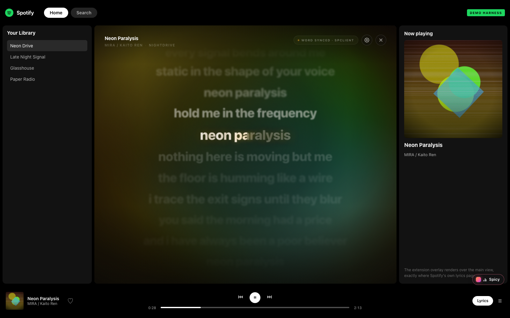
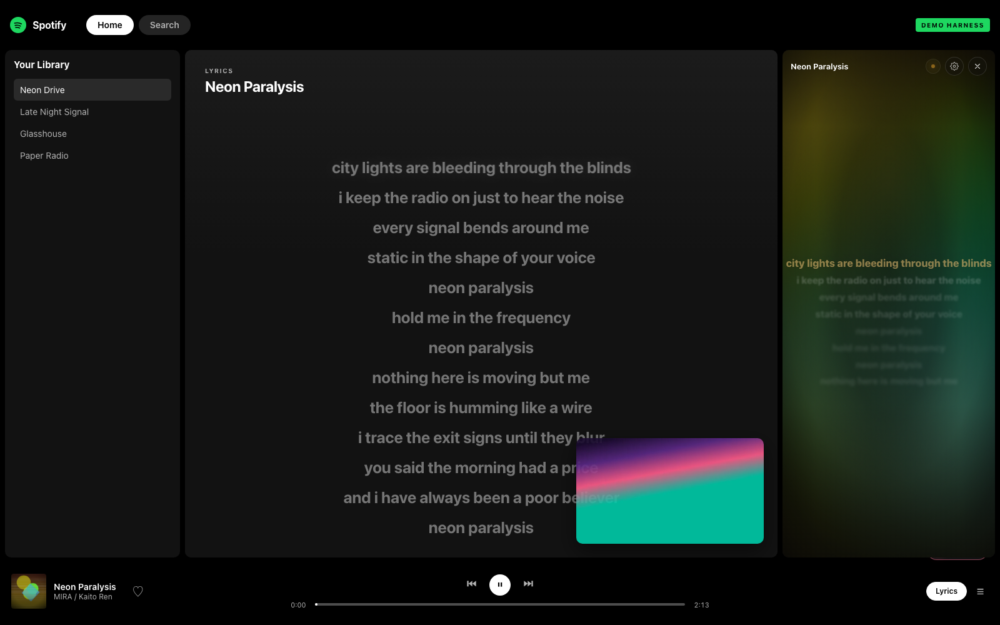
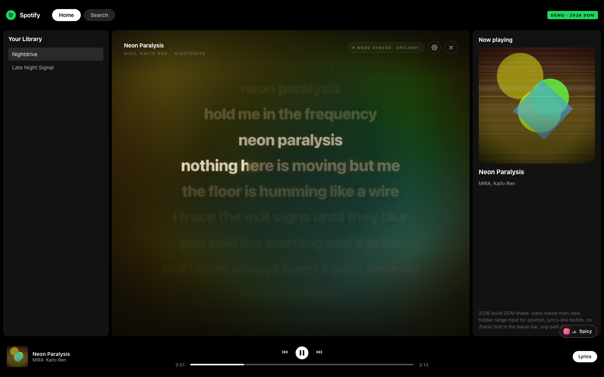
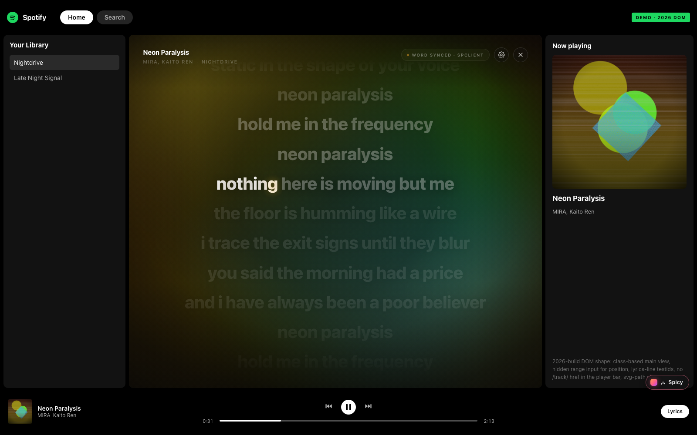
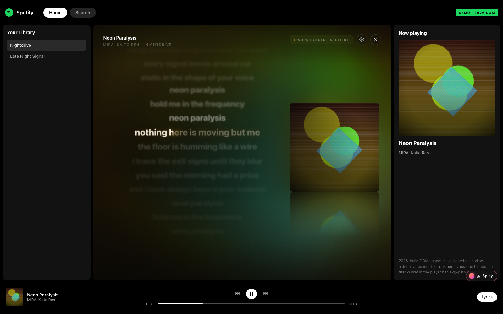
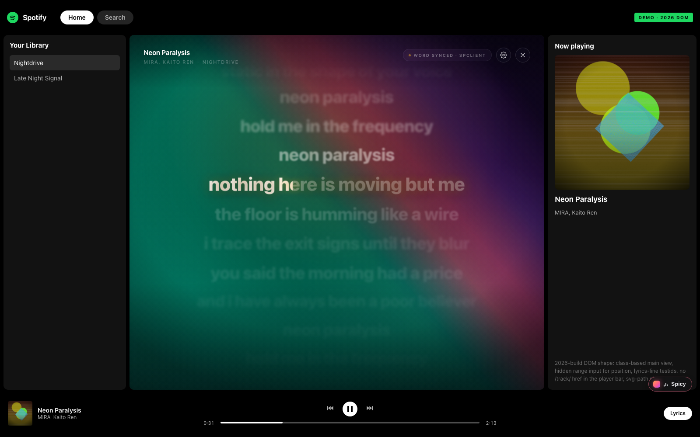
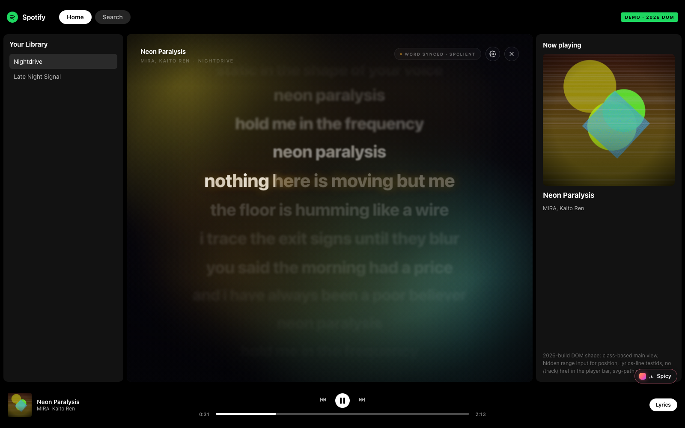
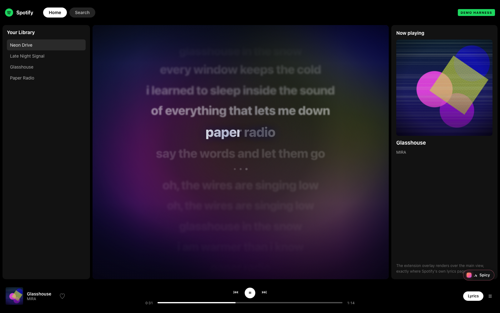
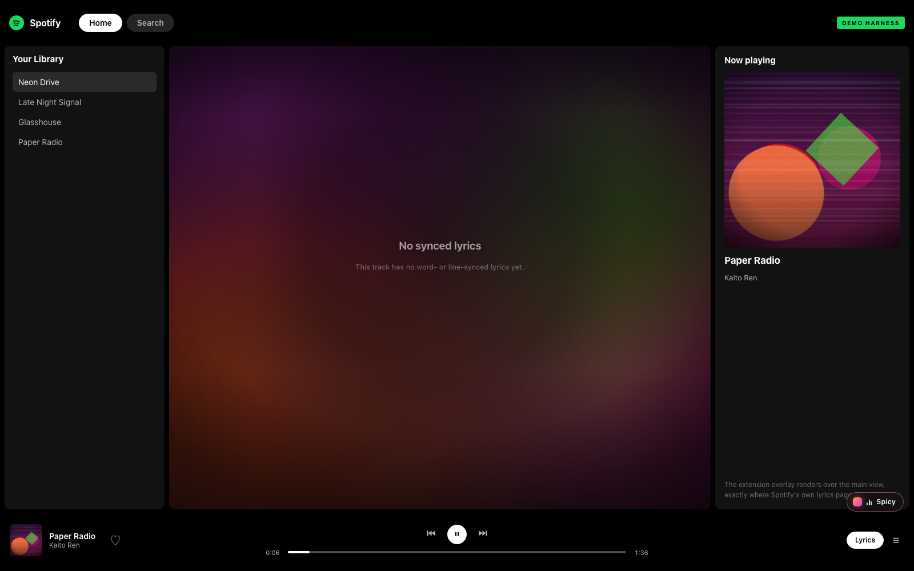

# Spicy Lyrics for Chrome

**非公式**の Chrome 拡張。Spotify デスクトップクライアント用 Spicetify 拡張 [spicylyrics.org](https://spicylyrics.org/) を、ブラウザの Spotify Web Player（`open.spotify.com`）向けに再構築したもの。

Spotify Web Player がデフォルトで取得・表示している歌詞をそのまま読み取り、デスクトップ版と同じ「単語ごとに光る歌詞ページ」として描画する。

[](https://github.com/4uthen7/spicy-lyrics-chrome/actions/workflows/ci.yml)
[](https://github.com/4uthen7/spicy-lyrics-chrome/releases/latest)
[](LICENSE)


> Spotify AB とは提携・承認・後援関係にない独立実装。元プロジェクト（Spicetify 拡張）のコードは含まない。



## できること

- 再生中の曲を **Spotify 純正のデータだけ**から判定（MediaSession ＋ プレイヤーバー DOM ＋ ページタイトル。サードパーティの歌詞 API は使わない）
- Spotify の歌詞ページを開くと、自動で Spicy の歌詞ページに置き換わる（メイン領域全体 / 右サイドバーの 2 モード）
- **単語単位のカラオケ塗り**（Spotify の color-lyrics payload に音節タイミングがある曲）。無い曲は行単位で塗る
- **3 つの歌詞モーション**: Cinema（スプリング追従）/ Flow（境界で止まらない連続スクロール）/ Simple（フラットで読みやすい）
- **6 種類の背景**: アルバムアートぼかし / ジャケット＋反射 / パレットグロー / 単色 / **ページ内の動画をミラー** / カスタム画像
- 間奏はドットアニメーション（4 秒以上のギャップを検出）
- ヘッダー（曲名 / アーティスト / アルバム / 同期種別 / 歌詞ソース）
- オーバーレイ内クイック設定（`G`）、拡張ポップアップ設定、`Alt+Shift+L` トグル
- 歌詞オフセット（±20 秒、`↑`/`↓` で 100ms ずつ）、行クリックでシーク
- ローカル TTML のインポート（ワード同期の手動適用）
- 歌詞キャッシュ（`chrome.storage.local`、240 曲 LRU）

| Cinema（メイン領域） | Panel（右サイドバー） |
| --- | --- |
|  |  |

| Flow（連続スクロール） | Simple（フラット） |
| --- | --- |
|  |  |

| ジャケット＋反射 | 動画ミラー |
| --- | --- |
|  |  |

| パレットグロー | 行同期 / 歌詞なし |
| --- | --- |
|  |   |

## 動作環境

- Chrome / Chromium 系ブラウザ **120 以上**（Manifest V3・`world: "MAIN"` content script を使用）
- Spotify Web Player（`https://open.spotify.com`）。無料アカウントでも動作する（再生できる曲のみ）
- ビルドする場合のみ Node.js 20 以上。実行時は依存パッケージ無し

## インストール

Chrome Web Store では配布していない。リリースの zip を展開して読み込む。

### A. リリースから（推奨）

1. [最新リリース](https://github.com/4uthen7/spicy-lyrics-chrome/releases/latest) から `spicy-lyrics-chrome-<version>.zip` をダウンロード
2. zip を展開する（`manifest.json` が直下に来るフォルダ）
3. `chrome://extensions` を開き、右上の **デベロッパー モード** を有効化
4. **パッケージ化されていない拡張機能を読み込む** → 展開したフォルダを選択
5. `https://open.spotify.com` を開いてタブを **リロード** し、曲を再生

### B. ソースからビルド

```bash
git clone https://github.com/4uthen7/spicy-lyrics-chrome.git
cd spicy-lyrics-chrome
node tools/build.mjs
# dist/prod を「パッケージ化されていない拡張機能」として読み込む
# dist/spicy-lyrics-chrome-<version>.zip も同時に生成される
```

インストール直後は既存タブに content script が入らないため、Spotify タブのリロードが必要。

## 使い方

- Spotify の歌詞ボタンを押す → そのまま Spicy の歌詞ページになる
- Spotify の歌詞を開かずに呼ぶ → 右下の **Spicy** ピル、または `Alt+Shift+L`
- 設定 → 拡張アイコンのポップアップ、オーバーレイ右上の歯車、または `G`
- オフセット → パネルの `−100 / +100`、または `↑` / `↓`
- 行をクリック → その行の頭にシーク
- `Esc` / `×` → 閉じる（曲が変わるまで自動では再表示しない。もう一度ピルかショートカットで開く）
- TTML を適用 → ポップアップ「Lyrics source」→ Import…

## 仕組み

### 再生中トラックの検出

プレイヤーバーの markup はビルドごとに変わります（v2 ウィジェットではタイトルの testid が付かないことがある）。そこで**3 系統を併用**し、どれか 1 つでも取れれば描画します。

1. **MediaSession**（第一候補）— Web Player は曲が変わるたびに `navigator.mediaSession.metadata` へ `{title, artist, album, artwork}` を設定します（配信バンドル内で確認済み）。言語に依存せず、DOM が変わっても生き残るため最も安定
2. **プレイヤーバー DOM** — `[data-testid="now-playing-widget"]` 内の title / artist / cover（複数の候補セレクタ＋ウィジェット内の可視線フォールバック）
3. **document.title** — `曲名 — song by アーティスト | Spotify` 形式の最後の保険

再生位置と曲長は隠し `<input type="range">` の value/max（ms）から、再生中かどうかは play/pause の SVG パス → MediaSession の `playbackState` → 位置差分の順で判定します。どれも取れない場合はポップアップに「player bar not detected」と表示され、**Copy diagnostics** で検出状況（各セレクタのヒット、MediaSession の有無、直近のエラー）を JSON としてコピーできます。

### 歌詞の取得経路（4 系統 + キャッシュ）

歌詞は **Spotify が再生時に読み込む純正の color-lyrics** をそのまま使います（サードパーティの歌詞 DB には一切アクセスしません）。

Spotify Web Player は、歌詞ビューを開いたときに `spclient.wg.spotify.com/color-lyrics/v2/track/<id>` を叩き、その JSON（行・音節タイミング・色）を描画しています。

1. **capture（既定・最優先）** — MAIN world で `fetch` / `XMLHttpRequest` を透過ラップし、Spotify 自身が取得した color-lyrics レスポンスを横取りする。実際のリクエストは `…/color-lyrics/v2/track/{id}/image/{encodedImageUrl}?format=json&vocalRemoval=false` という形。URL から track id を、リクエストヘッダから Bearer トークンも同時に控える（DOM には track id が無いため、ここが唯一の確実な取得点）
2. **direct** — 控えた Bearer トークンで `spclient` を直接取得（401 なら再取得）。`get_access_token` は 2026 ビルドでは 403 で塞がれており、TOTP 付き `/api/token` のみが通るため、トークンはページの通信から拾う
3. **DOM** — ネイティブ歌詞ビュー（`[data-testid="lyrics-line"]` / `fullscreen-lyric`）から行を抽出し、アクティブ行の観測からタイミングを学習するライン同期フォールバック
4. **cache** — 一度取得した歌詞は `chrome.storage.local` に保存

解決順は `cache → capture（最大1.2秒待機）→ direct（6秒）→ DOM → 空`。再生中の曲が変わると進行中の解決は破棄される。

**bootstrap**: 歌詞データは Spotify の歌詞ビューを開いた時点で取得されるため、歌詞がまだ無い曲では 2.5 秒後に **Spotify 自身の歌詞ボタンを自動クリック**し、Spotify にリクエストさせてその応答を読み取ります（設定「Read Spotify lyrics automatically」でオフ可能）。ユーザーが何もしなくても、デフォルトの Spotify と同じデータで描画されます。

### パース

- **color-lyrics v2**: `lines[].startTimeMs` / `endTimeMs`（文字列）、`words`、`syllables[{startTimeMs, endTimeMs, numChars}]`。`syncType` は実測で `LINE_SYNCED` / `SYLLABLE_SYNCED`。`syllables` があり `numChars` の合計が行テキスト長と一致すれば **word 同期**（Web Player 自身は音節を無視して行単位で描くため、payload に載っている場合のみ恩恵がある）、それ以外は **line 同期**、`UNSYNCED` は **static**。行間 4 秒以上のギャップは interlude 行として合成
- **TTML**: `<p begin end>` / ネストした `<span begin end>`、`ttm:role="x-bg"`（バックコーラス）、`ttm:agent`（デュエット左右）
- **DOM**: 行テキストの時刻サフィックス除去、`aria-current` / クラス / インライン不透明度からアクティブ行を判定し、観測した再生位置でタイミングを学習

### 描画

- Shadow DOM に隔離したオーバーレイが、Spotify のメイン領域（または右サイドバー）の矩形に追従する。Spotify 側の CSS と衝突しない
- `requestAnimationFrame` ループは store の再生位置（基準値 + 経過時間）を補間する。DOM 観測は 250ms 間隔、シーク検出時はスプリングを瞬間移動させる
- 単語 span の CSS 変数 `--p`（0→1）を書き換え、`background-clip: text` のグラデーションで塗る。span は再生成しない
- **歌詞モード**は 3 種類。Cinema はアクティブ行をステージ高さの 42% にスプリングで寄せ、非アクティブ行を距離に応じて減光・ブラー・縮小。Flow は行の開始/終了時刻の間を補間して**境界で止まらない連続スクロール**にし、次の行が早めに明るくなる。Simple は拡大・ブラー・傾きをやめたフラット表示（単語塗りは維持）
- **背景**は 6 種類。アルバムアートを 32×32 に縮小して量子化したパレットから、ぼかしアート（Ken Burns ドリフト＋ビネット＋グレイン）、ジャケット＋反射パネル、グローブロブ、単色、**ページ内 `<video>` のフレームミラー**（動画曲・ビデオポッドキャスト）、カスタム画像を生成。画像が取れない場合は track id のハッシュから安定したパレットを作る
- 動画ミラーは元の `<video>` を一切操作せず、`requestVideoFrameCallback` で 1 枚の canvas に cover  crop して描くだけ（tainted canvas のまま表示し、ピクセル読み出しはしない）

### 検証の考え方

`docs/spotify-webplayer-notes.md` に、公開配信されている Web Player バンドルから抽出した `data-testid` 一覧、プログレスバーの実 DOM（隠し `<input type="range">` が真の位置ソース）、color-lyrics の仕様、確度をまとめてある。DOM セレクタはすべて「候補配列」なので、Spotify 側の変更は 1 行の追加で追随できる。

## 設定

| 設定 | 既定 | 内容 |
| --- | --- | --- |
| Enabled | on | 拡張全体の on/off |
| Auto-open on Spotify lyrics | on | 歌詞ページを開いたら自動で置き換える |
| Read Spotify lyrics automatically | on | 歌詞が無いとき Spotify の歌詞ボタンを自動クリックして読み取る |
| Mode | Cinema | Cinema = メイン領域全体 / Panel = 右サイドバー |
| Lyric motion | Cinema | Cinema / Flow（連続）/ Simple（フラット） |
| Word fill | Gradient | 単語塗りのスタイル（Gradient / Solid） |
| Background style | Album art | アルバムアート / ジャケット＋反射 / グロー / 単色 / 動画 / カスタム画像 |
| Minimal mode | off | ヘッダーや操作 UI を隠す |
| Show header | on | 曲情報ヘッダーの表示 |
| Interlude dots | on | 間奏のドット |
| Reduce motion | off | アニメーションを抑制 |
| Offset | 0 ms | 歌詞タイミング補正（±2000ms、↑↓ で 100ms） |
| Text size | 1.00x | 歌詞サイズ |
| Line spacing | 1.00x | 行間 |
| Background blur / dim | 90px / 0.48 | 背景のぼかしと暗さ |
| Background motion | on | 背景のドリフト（Ken Burns / ブロブ） |
| Dynamic background | on | 背景描画そのもの |

## 権限とプライバシー

- 要求する権限は `storage` のみ。`host_permissions` は Spotify（`open.spotify.com` / `spclient.wg.spotify.com`）とカバーアート CDN（`i.scdn.co` など）に限定
- 歌詞・設定は `chrome.storage` にローカル保存するだけ。外部サーバへ送信しない。アクセス解析も無し
- 通信は Spotify 自身のリクエスト（横取りするだけで新しい宛先は作らない）と、カバーアート画像の取得のみ
- トークンや Cookie を保存・送信・表示しない。取得した Bearer はページ内のフォールバック取得にその場で使うだけ

## 開発

```bash
git clone https://github.com/4uthen7/spicy-lyrics-chrome.git
cd spicy-lyrics-chrome
node tools/make-assets.mjs      # アイコンとデモ用カバー画像を生成
node tools/make-fixtures.mjs    # デモ用 color-lyrics フィクスチャを生成
node tools/build.mjs            # dist/prod + dist/spicy-lyrics-chrome-<ver>.zip
node tools/build.mjs --target dev   # dist/dev（デモ用ホスト権限つき）
node tools/test-lyrics.mjs      # パーサ/スニファのユニットテスト（19 件）
node tools/serve.mjs --port 8787    # デモ用 Spotify モック（http://127.0.0.1:8787/demo/）
node tools/e2e.mjs              # 実 Chrome に拡張をロードして 35 項目を検証
node tools/verify-prod.mjs      # prod パッケージを実 Chrome でロードして 10 項目を検証
```

`tools/e2e.mjs` は Chrome for Testing（`/tmp/cft/...`、`CHROME_BIN` で指定可）に `dist/dev` を実際にロードし、2 種類のモックページを操作して 35 項目を検証、スクリーンショットを `docs/screenshots/` に保存する。結果は `35/35 checks passed`。

- `demo/`（従来型 DOM）: content script 起動、プレイヤー状態、bootstrap による歌詞読み取り、word 同期、マウント、単語塗りの進行、ライン同期、歌詞なし、ランチャー、設定パネル、ポップアップ、パネル/ミニマルモード、ページ例外ゼロ
- `demo/index-real.html`（2026 ビルドの実 DOM 形状）: `/track/` リンクが無い状態からの sniff による track id 昇格、隠し `<input type=range>` からの再生位置、`lyrics-line` のユニーククラストークン、`.main-view-container` クラスへの追従
- `demo/index-real.html?no-dom-track=1`: プレイヤーバーからタイトル testid を消し document.title もシェル名にした状態で、MediaSession だけで曲を検出して描画できること
- 背景 6 種と歌詞モード 3 種、動画ミラー（`spicyVideo=mirror`）、ポップアップの診断メッセージ（実 content script とのやり取り）


`tools/verify-prod.mjs` は `dist/prod` を実 Chrome にロードし、prod manifest に localhost が混ざっていないこと、`open.spotify.com` 上で content script が起動して例外が出ないこと、web-accessible な CSS/アイコンが Spotify オリジンから解決できること、ポップアップが描画されることを 10 項目で検証する。

デモページの曲名・歌詞・カバーはすべて架空（`tools/make-assets.mjs` / `tools/make-fixtures.mjs` の生成物）。

## 構成

```
manifest.json                 MV3 定義（prod）
src/
  shared/contract.js          typedef・イベントバス・ユーティリティ
  shared/store.js             状態スパイン（再生位置の補間・設定・キャッシュ）
  background/service-worker.js インストール時既定値・コマンド・メッセージ
  content/
    inject-main.js            MAIN world: fetch/XHR スニファ + 直接取得
    bridge.js                 MAIN ↔ isolated のメッセージング
    lyrics/color-lyrics.js    color-lyrics v2 パーサ
    lyrics/ttml.js            TTML パーサ
    lyrics/dom-scraper.js     ネイティブ歌詞ビューの抽出とタイミング学習
    lyrics/sources.js         解決順・キャッシュ・TTML インポート
    player/state.js           DOM からのプレイヤー状態観測とシーク
    ui/background.js          パレット抽出と背景
    ui/lyrics-view.js         行/単語レンダラとスプリング
    ui/controls.js           ヘッダー・設定パネル・ステータス
    ui/overlay.js             Shadow DOM マウントと矩形追従
    styles/*.css              オーバーレイのスタイル
    app.js                    マウント制御・ランチャー・bootstrap
  popup/                      設定ポップアップ
demo/                         Spotify モック（検証用）
docs/
  spotify-webplayer-notes.md  実 Web Player の調査メモ（セレクタ・payload 仕様）
  evidence/                   調査時の実データ抜粋
  screenshots/                e2e / render lab のスクリーンショット
demo/index.html               従来型 DOM のモック
demo/index-real.html          2026 ビルドの DOM 形状のモック
tools/                        ビルド・テスト・e2e・アセット生成・静的サーバ
```

## 既知の制約

- **実アカウントでのログイン検証は未実施**。検証は (a) 公開配信バンドルから抽出した実 `data-testid` と実 DOM（未ログイン Web Player のプレイヤーバー）、(b) 仕様に沿って合成した color-lyrics payload、(c) モックページ上での実拡張ロード、の 3 点で行っている。セレクタは候補配列なので、実環境で差異が出た場合は `SL.player.SELECTORS` / `SL.lyrics.DOM_SELECTORS` に 1 行追加すれば直る
- **word 同期は Spotify の payload に音節タイミングがある曲のみ**。無い曲は行同期で表示される（デスクトップ版のように TTML から作ることはしない。ローカル TTML のインポートは可能）
- **DOM フォールバックはライン同期のみ**。かつ一度は Spotify の歌詞ビューを開く必要がある（capture 経路のため）。アクティブ行は「1 行だけが持つクラストークン」とスクロール位置から推定する
- **track id はプレイヤーバーの DOM に存在しない**（題名リンクは `/album/<id>` を指す）。そのため内部では `title|artist|album` の合成キーで状態とキャッシュを管理し、capture が URL から実 id を得た時点で昇格する
- **capture が主経路**。Spotify の Web Player はユーザーの歌詞ビュー表示時にしか color-lyrics を取りに行かないため、bootstrap（歌詞ボタンの自動クリック）が既定で有効。オフにすると「一度自分で Spotify の歌詞を開く」まで歌詞が出ない
- `direct` 経路はログイン済みセッションでのみ成立し得る（匿名セッションでは 403 / 400。実アカウントでの検証は未実施）
- **ローマ字化は未実装**。デスクトップ版は独自データで行うが、漢字の読みは形態素解析器が必要なため同梱していない。`LyricLine.romanized` を持つ歌詞（TTML 等）があれば描画は可能
- Spotify の DOM 変更で壊れ得る。`get_access_token` は環境によって 403 になる（その場合は capture / DOM 経路が使われる）
- Panel モードは、右サイドバーが存在しない画面（現行ビルドでは右サイドバーの testid が無い）ではメイン領域にフォールバックする
- オフセットは ±20 秒まで、キャッシュは 240 曲まで
- 動画背景はページ内に表示中の `<video>`（音楽ビデオ・ビデオポッドキャスト）がある場合のみ。無ければアルバムアート背景にフォールバックする
- 認証済みセッションでの実再生は未検証（MediaSession / DOM / モックでの検証）。検出できない場合はポップアップの Copy diagnostics で原因を特定できる

## リポジトリ

- 不具合報告・要望: [Issues](https://github.com/4uthen7/spicy-lyrics-chrome/issues)
- 変更履歴: [CHANGELOG.md](CHANGELOG.md)
- 設計メモ: [docs/spotify-webplayer-notes.md](docs/spotify-webplayer-notes.md)

## ライセンス

[MIT](LICENSE)。本拡張は独立実装であり、元プロジェクト [Spikerko/spicy-lyrics](https://github.com/Spikerko/spicy-lyrics)（AGPL-3.0）のコードは含まない。

## 非提携・クレジット

- 本拡張は独立実装。Spotify AB とは提携・承認・後援関係にない。Spotify は Spotify AB の商標
- 元プロジェクト: [Spikerko/spicy-lyrics](https://github.com/Spikerko/spicy-lyrics)（AGPL-3.0、Spicetify 拡張）。本リポジトリはその Chrome 向け再構築で、コードは共有していない
- デモ用の楽曲名・歌詞・カバー画像はすべて架空（生成物）
